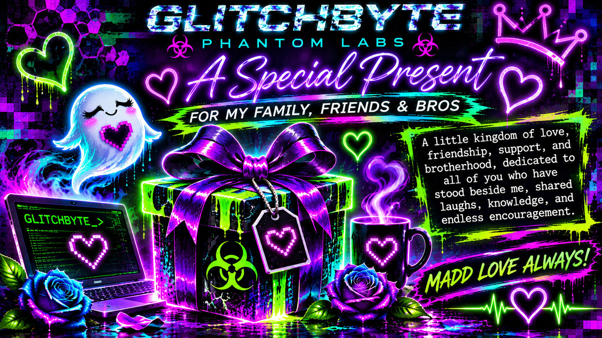

# 👻💜 GHOST HEART // GlitchByte Rainbow Kingdom

<p align="center"></p>

<p align="center"><strong>🎁 A little present for family, friends, and the brothers who helped the dreams bloom. 🐺💗</strong></p>

> Not every kingdom is made of castles. Some are made of friendship, code, and stubborn, beautiful dreams.

### 🌈 Open the gift

- 🎁 **[Visit the Rainbow Kingdom](https://hellfire13666.github.io/ghost-heart-rainbow-gift/)** (available once GitHub Pages is enabled)
- 🎨 **[Explore the Artwork Viewer](https://hellfire13666.github.io/ghost-heart-rainbow-gift/gallery.html)**
- 💌 **Copy the Terminal Love Note** using the glowing copy square on the gift page.

### 💗 What's inside?

The welcome story, the Termux-to-Linux journey, a tribute to brothers and friends, the twelve rainbow doorways, secret ghost notes, a tiny Heart Hax jar, and GlitchByte social links organized neatly at the **very bottom**.

The gift gallery contains the **existing original artwork**, grouped under `assets/art/` with small previews under `assets/thumbs/`. Nothing extra is scattered in the root directory. The website works without external frameworks, tracking, accounts, or server-side code.

### 🖥️ Terminal surprise

For anyone who wants to explore the rainbow terminal playplace locally, open `terminal/GHOST-HEART-RAINBOW-KINGDOM-PASTE.sh` and copy the whole paste into a Python 3 / Bash terminal, or run it from this repository folder:

```bash
bash terminal/GHOST-HEART-RAINBOW-KINGDOM-PASTE.sh
```

No installation required. The terminal program does not change local files or system settings.

### 📦 Repository map

```text
index.html               The gift webpage and terminal copy squares
gallery.html             Artwork viewer with previous/next and save
assets/
  art/                   Six curated, web-optimized present images
  thumbs/                Small preview images
  gallery.css            Gallery styling
  gallery.js             Viewer controls
  ghost-icon.png         Ghost Heart icon
  gift-cover.png         Original cover artwork
  welcome-art.webp       Original welcome artwork
terminal/
  GHOST-HEART-RAINBOW-KINGDOM-PASTE.sh
README.md                This welcome note
.nojekyll                GitHub Pages compatibility
```

### 🔐 Sharing note

The gift includes public project links and social accounts. Review them before publishing. Please do not add local paths, credentials, private photos, passwords, emails, or system details to a public repository. Git author identity for this release should be **Hellfire13666** using GitHub's no-reply email.

**KEEP GLITCHING. KEEP BLOOMING. MADD LOVE ALWAYS! 👻💚💜🌹**
